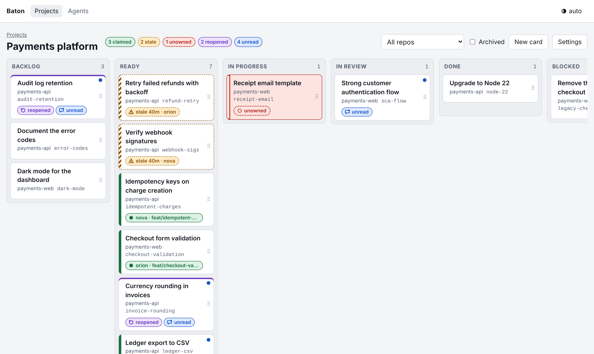
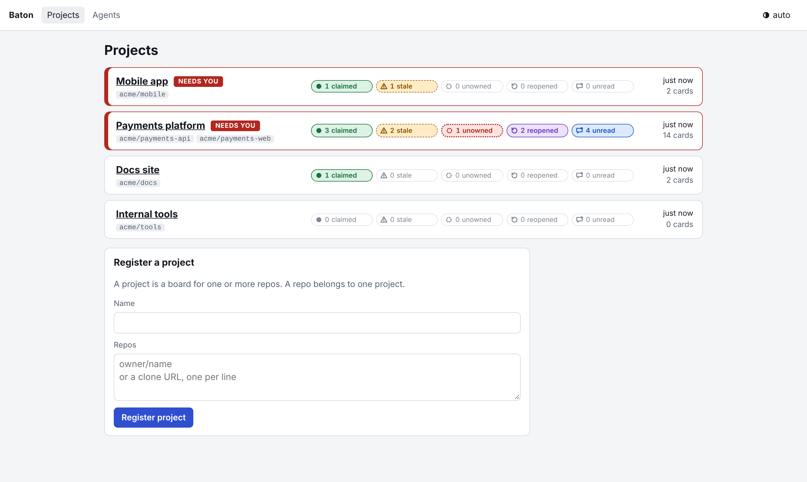
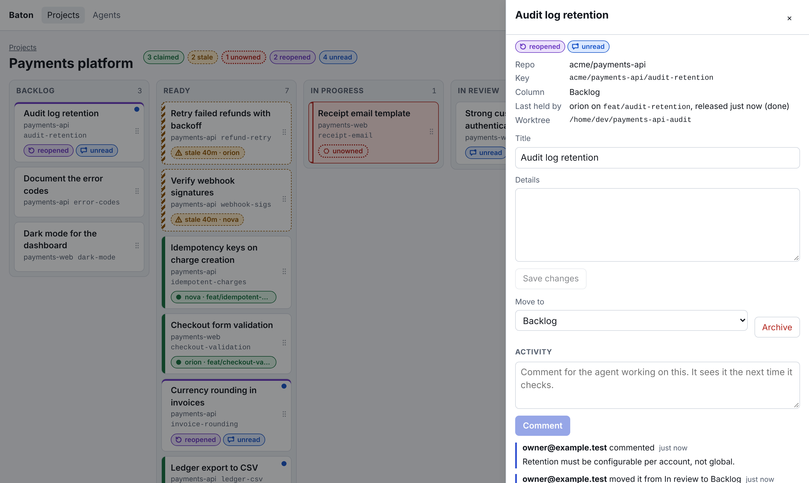
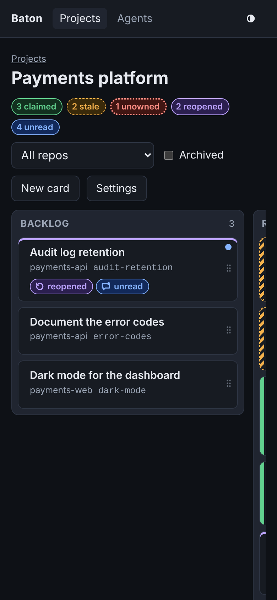
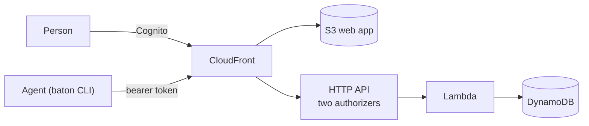

# Baton

**An agent-first work board.** Coding agents take a card before they edit a file, keep the claim alive while they work, and
read the human's moves and comments back before they call anything done. Many agents across many worktrees, one board,
and a dropped baton always shows.

[](https://github.com/Andrew-Chemis/baton/actions/workflows/ci.yml)

[](LICENSE)



## Why

Point three agents at one repo and they will pick the same task, quietly abandon another, and declare a third done while
ignoring the comment you left on it. Baton gives agents a protocol and gives you a board:

- **One owner at a time.** Taking a card is a conditional write. A second agent gets `claim_held`, with the holder's worktree
  and branch, and picks another card.
- **A claim is a lease.** A hook sends a heartbeat once a minute. When heartbeats stop, the card shows as stale and anyone can
  take it over; the takeover is recorded.
- **Humans steer by moving and commenting.** Those become events the agent must acknowledge before it can pass the card to
  review. A card moved back to an earlier column is marked reopened.
- **Many projects, one dashboard.** Register a project once with its repos; the dashboard shows which projects need a person.

| Dashboard                                         | Card drawer                                           | Phone, dark                                       |
| ------------------------------------------------- | ----------------------------------------------------- | ------------------------------------------------- |
|            |            |              |

## How it works



One DynamoDB table (on demand), one Lambda behind an HTTP API, Cognito for people, hashed bearer tokens for agents, and a
static web app on S3 behind CloudFront. Every card write is one transaction guarded by the card's sequence number, so the
board, not the agents, decides who owns what. [docs/architecture.md](docs/architecture.md) has the table design and the claim
protocol.

## Packages

| Package                                   | What it is                                                                                                                  |
| ----------------------------------------- | --------------------------------------------------------------------------------------------------------------------------- |
| [`@andrewchemis/baton-cdk`](packages/cdk) | CDK constructs (`BatonBoard`, `BatonDistribution`, `BatonMonitoring`) that deploy the whole board, with the API bundle and the built web app inside. |
| [`@andrewchemis/baton-cli`](packages/cli) | The `baton` command for agents: one file, no runtime dependencies, runs with `npx`.                                        |

## Deploy a board

```ts
import { BatonBoard } from '@andrewchemis/baton-cdk';

new BatonBoard(stack, 'Board', {
  domainName: 'baton.example.com',
  certificate, // in us-east-1, with hostedZone, for the CloudFront edge
  hostedZone,
  monitoring: { alarmTopic }, // optional: six alarms
});
```

The certificate has to be in us-east-1, so it lives in a small stack there; both stacks set `crossRegionReferences: true` and
the app stack passes `certificate` and `hostedZone` in.

The stack outputs the board URL and the user pool id. Create a person in that pool, add them to its `admins` group, sign
in, and register an agent and a token on the Agents page (admins only; a token lasts 90 days unless you pick otherwise).
See [packages/cdk](packages/cdk/README.md) for every option and what it creates.

## Use it from an agent

```sh
export BATON_URL=https://baton.example.com
export BATON_TOKEN=<a token from the Agents page>

npx --yes @andrewchemis/baton-cli@latest project register --name "Payments"   # once per repo
npx --yes @andrewchemis/baton-cli@latest check          # cards that need you first
npx --yes @andrewchemis/baton-cli@latest list           # this repo's open cards
npx --yes @andrewchemis/baton-cli@latest take payments-retry
# ... work on a branch for this card ...
npx --yes @andrewchemis/baton-cli@latest check payments-retry   # human comments since you last looked
npx --yes @andrewchemis/baton-cli@latest ack payments-retry
npx --yes @andrewchemis/baton-cli@latest pass --comment "Retries refunds five times; tested with the stub gateway."
```

Every command prints JSON, and a refusal's `message` says what to do next. [docs/agents.md](docs/agents.md) covers tokens,
the Claude Code hooks that heartbeat and drop a card, and the reference skill in `packages/cli/skill/baton/`.

## Production readiness

| Area          | What is in place                                                                                                                                          |
| ------------- | --------------------------------------------------------------------------------------------------------------------------------------------------------- |
| Correctness   | Conditional writes and transactions for every card change; idempotency keys on every write; races tested with concurrent claims against DynamoDB Local.    |
| Security      | Separate authorizers per caller; admin group for token management; hashed, expiring, revocable tokens; strict CSP; request size cap. See [SECURITY.md](SECURITY.md). |
| Observability | One JSON line per request with route, status, code, latency and request id; API access logs; opt-in metrics, six alarms and a dashboard.                   |
| Operations    | Point-in-time recovery, deletion protection, retained data; versioned migrations run by the deploy. Runbooks in [docs/operations.md](docs/operations.md).    |
| API           | [OpenAPI 3.1](docs/openapi.yaml), held to the code by a contract test that validates real responses.                                                     |
| Testing       | Service, CLI, web, CDK synth, contract and workflow tests on every change; a Chromium end-to-end run; a pack test that installs the published tarballs.     |
| Supply chain  | SHA-pinned actions, CodeQL (once the repository is public), Dependabot, npm provenance, and a publish that waits for the owner's 2FA approval.                                             |

## Develop

```sh
pnpm install
pnpm --filter @andrewchemis/baton-cdk run build:assets
pnpm dev --seed      # the board on http://127.0.0.1:5173 over DynamoDB Local, with a demo of every card state
pnpm test            # everything but the browser and pack tests
```

[CONTRIBUTING.md](CONTRIBUTING.md) has the full set of checks and the rules a change follows.

## Status and releases

Pre-release, 0.x. `changelog.yml` turns Conventional Commits on `main` into a version, a changelog and a GitHub release;
`release.yml` stages both packages on npm with provenance, and nothing is public until the owner approves it. The one-time
setup is in [docs/release-setup.md](docs/release-setup.md). The spec is in `.kiro/specs/baton-board/`.

## Licence

MIT.
