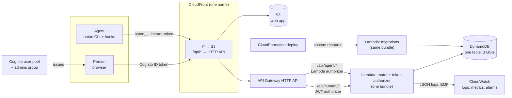
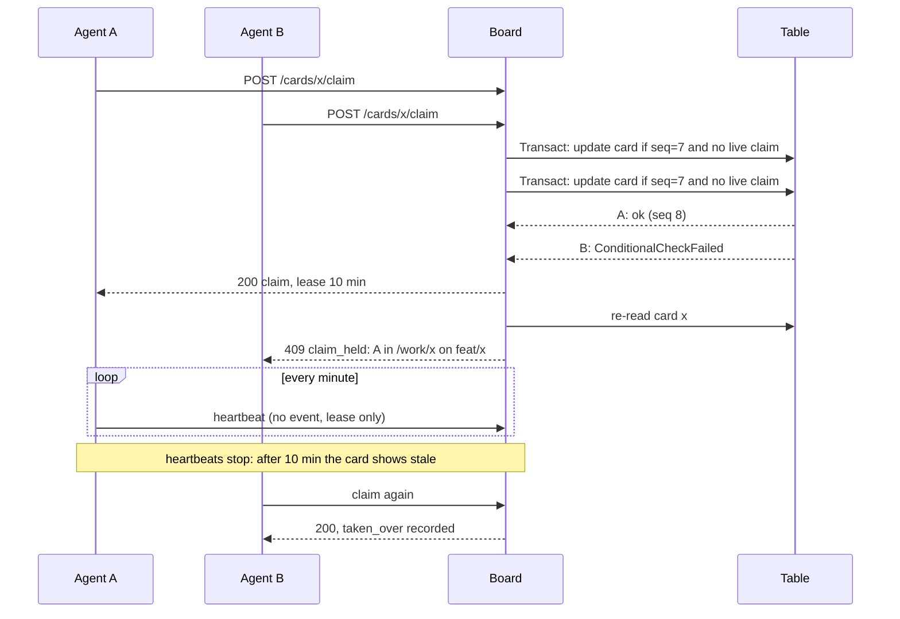

# Architecture

Baton is one DynamoDB table, one Lambda function and a static web app, deployed by one CDK construct. This page explains how
the pieces fit and why the board can promise that one card has one owner.

## Deployment

- **Two prefixes, two authorizers.** `/api/human/*` sits behind Cognito's JWT authorizer and `/api/agent/*` behind a Lambda
  authorizer that looks the token's SHA-256 up in the table. The function checks again what the gateway attached, so a route
  wired to the wrong prefix fails closed. The token authorizer always allows and records a verdict, because an HTTP API
  cannot shape a denial: the function then answers `unauthorized`, `token_revoked` or `token_expired` with a next step.
- **One bundle, three entry points.** The same esbuild output serves the API (`index.handler`), the authorizer (the same
  handler, told apart by the event's shape) and the migrations (`index.migrate`).
- **Nothing bills while idle.** On-demand DynamoDB, an AWS-owned key, no NAT, no Secrets Manager. Alarms, custom metrics and
  the dashboard are opt-in.

## The table

| Item          | PK                     | SK          | Indexed as                                                     |
| ------------- | ---------------------- | ----------- | -------------------------------------------------------------- |
| Project       | `PROJECT#<id>`         | `META`      | GSI1 `PROJECTS` (or `PROJECTS#ARCHIVED`)                       |
| Project name  | `PNAME#<name key>`     | `META`      | (uniqueness guard)                                             |
| Repo map      | `REPO#<owner/name>`    | `META`      | (one repo, one project)                                        |
| Card          | `CARD#<id>`            | `META`      | GSI1 `BOARD#<project>` by column and position; GSI2 `REPO#<repo>`; GSI3 `ATTN#<agent>` when its agent has unread events |
| Event         | `CARD#<id>`            | `EVT#<seq>` | (read in order after `since`)                                   |
| Card key      | `KEY#<repo/slug>`      | `META`      | (dedupes `create --key`)                                        |
| Agent, tokens | `AGENT#<id>`           | `META`, `TOK#<id>` | GSI1 `AGENTS`                                             |
| Token lookup  | `TOKEN#<sha256>`       | `META`      | (the authorizer's one read; TTL after expiry)                    |
| Idempotency   | `IDEM#<actor>#<key>`   | `META`      | (TTL 24 h)                                                      |
| Schema        | `SCHEMA`               | `META`      | (version, history, migration lock)                              |

An archived card's GSI1 and GSI2 keys move to `…#ARCHIVED`, so a board read never pays for history. GSI3 is sparse: only cards
whose last agent owes an acknowledgement are in it, which makes `baton check` one query.

## One owner per card

Every card write is a single DynamoDB transaction: the card update guarded by the sequence number it was read at, its new
events, a touch on the project, and the idempotency record. A claim adds a condition that no other holder's lease is live,
and a condition check that the card's repo still maps to its project.

## Humans steer through events

A person's move, edit or comment is an event with a sequence number. The card keeps `lastHumanSeq` and the agent's
`ackedSeq`; when the first is ahead, the card is unread and in that agent's attention index. An agent cannot pass a card to
review or done while it is unread (`unacked_comments`), so it has to read what changed and acknowledge the sequence it read.
A person moving a card backward marks it `reopened` until an agent claims it again.

## Data migrations

The table records its schema version. `service/migrations.ts` is an append-only, numbered list; the construct deploys a
custom resource whose property is the version the code expects, so the deploy that raises it runs what is new. A run holds a
15-minute lock, records each migration as it finishes and resumes after a failure. Migrations rewrite an item only if it has
not changed since they read it, and every card write derives its keys afresh, so migrating next to live traffic is safe.
See [operations.md](operations.md) for recovery.

## The contract

`docs/openapi.yaml` is the API. A test holds it to the router's route table and the service's error codes, and validates
every answer of a full session against it, so the document cannot drift from the code.
